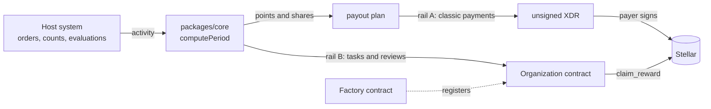

# Harmony — on-chain performance payroll

Harmony turns the work that warehouse operators already record (orders picked,
orders packed, inventory lines counted) into points, and pays a bonus pool in
USDC on Stellar in proportion to those points.

It is **multi-tenant**: every organization (tenant) has its own Soroban
contract, reward asset, payer wallet, payout caps and scoring weights, and the
off-chain engine only ever works with the configuration it is given.

```
contracts/          Soroban contracts (Rust)
  factory/          registry of organization contracts (one per tenant)
  organization/     members, tasks, periods, funding and claims of one tenant
packages/core/      off-chain engine (Node.js): scoring, payout planning,
                    non-custodial payment transactions, Soroban client
docs/               architecture, contract reference, scoring, payouts
docs/audit/         audit guide, findings, threat model, deployments
examples/           runnable examples (no network needed)
```

## Status

| Component | Status |
|---|---|
| Organization + Factory contracts | Testnet pilot. Reference deployment and source equivalence in [docs/audit/deployments.md](docs/audit/deployments.md). **Not deployed on mainnet.** |
| Scoring engine (`packages/core`) | Extracted from a warehouse management system where it runs in production. This package is the database-free version of that logic. |
| Direct-payment rail | Used on mainnet to pay campaign bonuses in USDC. Non-custodial: the payer signs in its own wallet. |

Known issues are disclosed in [docs/audit/findings.md](docs/audit/findings.md),
each with a test that reproduces it.

## How it works



1. The host system reports activity per worker and period.
2. `computePeriod` computes velocity, precision, attendance and leader
   evaluation scores, adjusts the points and assigns each worker a share of the
   period's fund (optionally only to the top-N).
3. The bonus is paid through one of two rails:
   - **Direct payment** (production): the engine plans the split and builds
     unsigned transactions; the payer signs them in its wallet; the engine
     validates every operation before submitting.
   - **Organization contract** (pilot): the fund is deposited into the
     tenant's contract and each worker claims its proportional share.

Details: [docs/architecture.md](docs/architecture.md) ·
[docs/multi-tenant.md](docs/multi-tenant.md) ·
[docs/scoring.md](docs/scoring.md) · [docs/payouts.md](docs/payouts.md) ·
[docs/integration.md](docs/integration.md)

## Quick start

Requirements: Rust (the toolchain is pinned in `contracts/rust-toolchain.toml`),
Stellar CLI ≥ 22, Node.js ≥ 20.

```bash
# Contracts (from the repository root)
(cd contracts && cargo test && cargo build --target wasm32-unknown-unknown --release)

# Off-chain engine
(cd packages/core && npm ci && npm test)

# Example, offline (needs the npm ci above)
node examples/inventory-campaign.js
```

```js
const { createHarmony } = require('@zelena/harmony-core');

const acme = createHarmony({
  id: 'acme-warehouse',
  network: 'testnet',
  contracts: { organization: 'C...' },
  payouts: { caps: { perPerson: 100, perBatch: 1000 } },
});

const period = acme.computePeriod({ kind: 'orders', activity, fundTotal: 150 });
const plan = acme.planCampaignPayout({ ranking, options: { base: 0, pool: 150, topN: 5 } });
```

## For auditors

Start with [docs/audit/README.md](docs/audit/README.md): scope, exact build
and test commands, trust model, invariants and the list of known issues.

## Security

Report vulnerabilities privately; see [SECURITY.md](SECURITY.md).

## License

[MIT](LICENSE) © 2026 Zelena Tech

---

### Resumen en español

Harmony convierte el trabajo que ya registra el equipo de bodega (pedidos
alistados y empacados, líneas de inventario contadas) en puntos, y reparte un
bono en USDC sobre Stellar en proporción a esos puntos. Es **multi-tenant**:
cada empresa tiene su propio contrato, activo de pago, wallet pagadora, topes y
pesos de puntaje. Los contratos están en piloto en testnet; el pago directo ya
se usa en mainnet. La documentación técnica está en inglés para facilitar la
auditoría del ecosistema Stellar.
