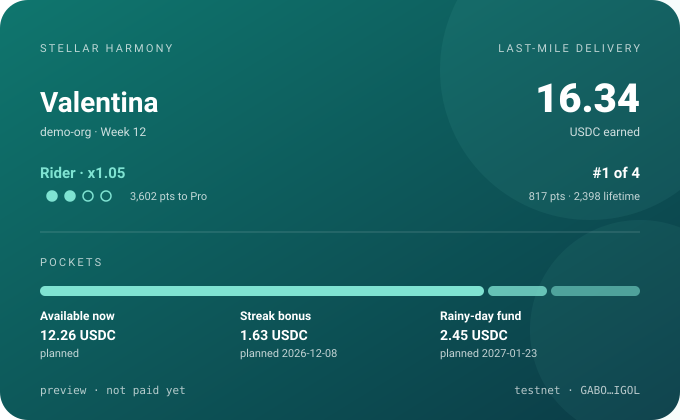
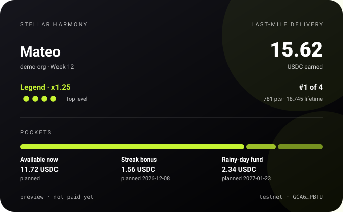
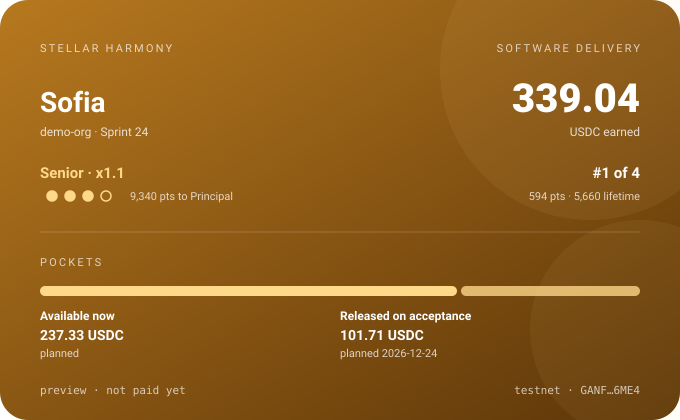
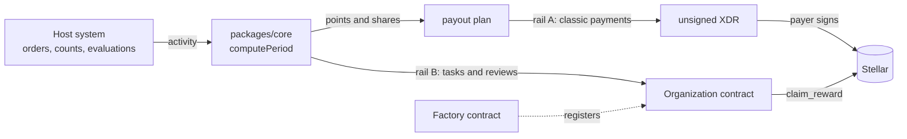

# Stellar Harmony

Turn the work a system already records into points, levels and pockets, and
pay it on Stellar without holding anybody's keys.

<p>
  
  
  
</p>

Harmony was born inside a warehouse management system. `packages/kit` now
generalizes it to couriers, sales, support, contractors, collections and
software teams. It is non-custodial: it builds unsigned transactions and the
payer signs in its own wallet. It is **multi-tenant**: every organization (tenant) has its own Soroban
contract, reward asset, payer wallet, payout caps and scoring weights, and the
off-chain engine only ever works with the configuration it is given.

```
contracts/            Soroban contracts (Rust)
  factory/            registry of organization contracts (one per tenant)
  organization/       members, tasks, periods, funding and claims of one tenant
packages/core/        off-chain engine (Node.js): scoring, payout planning,
                      non-custodial payment transactions, Soroban client
packages/kit/         programs, levels, payout models, pockets, claimable
                      balances, Harmony Cards, 14 industry templates
packages/connectors/  work events from GitHub, Azure Boards and any CSV export;
                      export of a plan to the Stellar Disbursement Platform
docs/                 architecture, scoring, payouts, kit, use cases, adoption
                      levels, hackathon guide; docs/audit/ for auditors
examples/             quickstarts, software team, use cases from a CSV,
                      private payouts
```

## Status

| Component | Status |
|---|---|
| Organization + Factory contracts | Testnet pilot. Reference deployment and source equivalence in [docs/audit/deployments.md](docs/audit/deployments.md). **Not deployed on mainnet.** |
| Scoring engine (`packages/core`) | Extracted from a warehouse management system where it runs in production. This package is the database-free version of that logic. |
| Direct-payment rail | Used on mainnet to pay campaign bonuses in USDC. Non-custodial: the payer signs in its own wallet. |
| Kit (`packages/kit`) | New in this release. Tested offline and on testnet. Not audited. |
| Connectors (`packages/connectors`) | New in this release. Tested offline and on testnet. Not audited. |

Known issues are disclosed in [docs/audit/findings.md](docs/audit/findings.md),
each with a test that reproduces it. Nothing is published to npm yet: clone
the repository. Review the kit yourself before using it with real money.

## The kit in 15 lines

```js
const { createProgram } = require('./packages/kit/src');

const tenant = { id: 'acme-couriers', network: 'testnet' };
const harmony = createProgram({ tenant, program: 'last-mile-delivery' });   // a template or your own

const { standings } = harmony.score({ events });       // [{ participantId, metric, value }]
const plan = harmony.plan({ standings, people });      // people: { id: { name, wallet } }
const built = await harmony.build({ plan, payer });    // unsigned XDR: nothing is signed here
// the payer signs built.xdrs in its own wallet, then:
const receipt = await harmony.submit({ built, signedXdrs });
const card = harmony.card({ participant, standing: standings[0], payment: plan.payments[0], receipt });
```

A **program** is metrics that give points, **levels** that multiply them, a
payout model and **pockets**: each reward is split into parts that are paid
now, expire (claim before a date or it returns to the payer) or unlock on a
date. Someone who cannot receive yet is not skipped: the money waits and they
claim it with one signature. Pockets control when money becomes available, not
where it is spent afterwards.

Read: [kit reference](docs/kit.md) · [use cases and the 14 templates](docs/use-cases.md) ·
[adoption levels](docs/adoption-levels.md) · [build with it in 10 minutes](docs/hackathon.md)

## How it works (engine and contracts)



1. The host system (a warehouse management system, a delivery app, a ticket
   tool, a repository) reports activity per person and period.
2. `computePeriod` computes velocity, precision, attendance and leader
   evaluation scores, adjusts the points and assigns each worker a share of the
   period's fund (optionally only to the top-N).
3. The bonus is paid through one of two rails:
   - **Direct payment** (production): the engine plans the split and builds
     unsigned transactions; the payer signs them in its wallet; the engine
     validates every operation before submitting.
   - **Organization contract** (pilot): the fund is deposited into the
     tenant's contract and each worker claims its proportional share.

Details: [docs/architecture.md](docs/architecture.md) ·
[docs/multi-tenant.md](docs/multi-tenant.md) ·
[docs/scoring.md](docs/scoring.md) · [docs/payouts.md](docs/payouts.md) ·
[docs/integration.md](docs/integration.md)

## Quick start

Requirements: Rust (the toolchain is pinned in `contracts/rust-toolchain.toml`),
Stellar CLI ≥ 22, Node.js ≥ 20, and Docker for the reproducible build.

```bash
# Contracts (from the repository root)
(cd contracts && cargo test)

# Reproducible release build, checked against contracts/wasm.sha256
scripts/build-wasm.sh --check

# Off-chain engine
(cd packages/core && npm ci && npm test)

# Example, offline (needs the npm ci above)
node examples/inventory-campaign.js

# Kit and connectors (the connectors have no dependencies to install)
(cd packages/kit && npm ci && npm test) && (cd packages/connectors && npm test)
node examples/quickstart-offline.js
```

```js
const { createHarmony } = require('@zelena/harmony-core');

const acme = createHarmony({
  id: 'acme-warehouse',
  network: 'testnet',
  contracts: { organization: 'C...' },
  payouts: { caps: { perPerson: 100, perBatch: 1000 } },
});

const period = acme.computePeriod({ kind: 'orders', activity, fundTotal: 150 });
const plan = acme.planCampaignPayout({ ranking, options: { base: 0, pool: 150, topN: 5 } });
```

## For auditors

Start with [docs/audit/README.md](docs/audit/README.md): scope, exact build
and test commands, trust model, invariants and the list of known issues.

## Security

Report vulnerabilities privately; see [SECURITY.md](SECURITY.md).

## License

[MIT](LICENSE) © 2026 Zelena Tech

---

### Resumen en español

Stellar Harmony convierte el trabajo que un sistema ya registra (pedidos
alistados, entregas, ventas, tickets, tareas de software) en puntos, niveles y
bolsillos, y lo paga en Stellar sin custodiar las llaves de nadie: el pagador
firma en su propia wallet. Nació en un sistema de gestión de bodega y es
**multi-tenant**: cada empresa tiene su propio activo de pago, wallet pagadora,
topes y pesos de puntaje. El nuevo kit (`packages/kit`) añade programas con
niveles, modelos de pago y bolsillos (pago inmediato, saldo que vence y vuelve
al pagador, o saldo que se libera en una fecha); quien aún no puede recibir no
se omite: su dinero espera y lo reclama con una firma. Los conectores
(`packages/connectors`) leen GitHub y Azure Boards. El kit y los conectores son
nuevos, probados sin red y en testnet, y **no están auditados**. Los contratos
están en piloto en testnet; el pago directo ya se usa en mainnet. La
documentación técnica está en inglés para facilitar la auditoría del
ecosistema Stellar.

---

Stellar is a trademark of the Stellar Development Foundation. This project is
independent and is not affiliated with or endorsed by the Stellar Development
Foundation.
