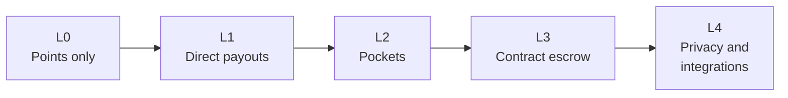

# Adoption levels

An organization does not need to adopt everything at once. Each level below
runs on its own and builds on the one before. Stop at the level that fits your
risk, your team and your regulator.



## Status today

| Level | What it is | Status today | Where |
|---|---|---|---|
| L0 Points only | score, ranking, card preview | Offline. New in 0.2.0, tested offline, not audited | `packages/kit` |
| L1 Direct payouts | plan, unsigned XDR, payer signs | **Production** in the core rail (the kit adds a new builder on top: new, tested offline and on testnet, not audited) | `packages/core`, `packages/kit` |
| L2 Pockets | claimable balances: expiring, unlocking, hold | **Testnet-proven only**. New, not audited | `packages/kit` |
| L3 Contract escrow | fund held by the Organization contract, each person claims | **Testnet pilot**. Not on mainnet | `contracts/organization`, [audit](audit/README.md) |
| L4 Privacy and integrations | confidential payouts; Stellar Disbursement Platform export; escrow services | Privacy: **example**, tested on testnet. SDP export: **in progress in this release**. Escrow services: **planned** | `examples/private-payouts`, `packages/connectors` |

"Production" means the direct-payment rail in `packages/core` is used on
mainnet to pay campaign bonuses, starting from the warehouse system it was
extracted from. It does not mean that the kit has been audited.

## L0 Points only

**You need:** Node 20 and a list of events. No wallet, no network.

**You get:** points per person, levels, a ranking, and a card preview
(`preview: true`, JSON and SVG) that shows what a person would earn.

```js
const { standings } = harmony.score({ events });
const cardJson = harmony.card({ participant, standing: standings[0], of: standings.length });
const svg = harmony.renderCardSvg(cardJson);
```

Why start here: you test your rules with real data and show people the
ranking before any money moves. Run `examples/quickstart-offline.js`.

No API access yet? A CSV export is enough: `csvEvents` (in
`packages/connectors`) maps the columns to events, reports every row it could
not use, and `examples/use-cases/run.js` shows the ranking and a payout preview
for logistics, supplier payments and collections. See
[examples/use-cases](../examples/use-cases/README.md).

## L1 Direct payouts

**You need:** a payer wallet that holds the reward asset (USDC) and some XLM;
a Stellar address for each person who is paid; a way for the payer to sign
(a wallet app such as Freighter, or your own signer). Recipients also need a
trustline for the asset, but see L2 if they do not have one.

**You get:** a plan with the amount per person, unsigned transactions, a
validation before sending, and public proof of each payment. The planner
enforces caps, withholds the share of people with no address instead of
giving it away, and refuses to pay the same bonus twice when you pass the
history.

Flow: `plan` then `build` then the payer signs in its own wallet then
`submit`. The kit holds no keys. In `build`, a recipient with no account or no
trustline is skipped when `unreachable.mode` is `skip`. Use only `instant`
pockets at this level.

The rail in `packages/core` (`planCampaignPayout`, `buildPayoutTransactions`,
`submitSignedTransactions`) is the one used in production. The kit's `build`
is a newer implementation that also creates claimable balances.

## L2 Pockets

**You need:** everything in L1. The payer needs extra XLM for reserves: 0.5
XLM per claimant of each claimable balance, returned when it is claimed.

**You get:**

- **Expiring pockets** (`expires`): a reward to claim before a date; after it,
  the payer can take it back.
- **Unlocking pockets** (`unlocks`): savings or retention that the person can
  claim only from a date. The payer can never take it back, except from someone
  who could not receive yet (no account or no usable trustline), and then only
  after the unlock date plus the reclaim window.
- **Hold:** a person with no account or no trustline is not skipped. Their
  money waits as a claimable balance and they claim it with one signature
  that also adds the trustline. The account itself must exist (a first XLM
  deposit).
- A Harmony Card with a status per pocket.

Limits to know: pockets are time rules. They do not control where money is
spent after the claim, and they cannot wait for an approval. Status: tested on
testnet only. Run `examples/quickstart-testnet/run.js [templateId]`.

## L3 Contract escrow

**You need:** the Organization contract deployed for your tenant, a funder
account, and people with the right roles (the contract has its own role matrix).

**You get:** the period fund is deposited in the contract, points are frozen at
distribution, and each person calls `claim_reward` for their proportional
share. Approval of work can be part of the flow: a supervisor reviews tasks
before the period is closed. This is the answer when a release must depend on
someone's approval, which pockets cannot express.

Status: **testnet pilot, not deployed on mainnet.** Known issues are listed in
[audit/findings.md](audit/findings.md), and the deployment evidence is in
[audit/deployments.md](audit/deployments.md). The kit does not drive this
contract yet; use `packages/core` (`createOrganizationClient`) and the
[contract reference](contracts/organization.md).

## L4 Privacy and ecosystem integrations

Three independent options. None is required.

- **Confidential payouts.** `examples/private-payouts` pays through a
  confidential token so that the amount of each transfer does not appear on
  the public ledger. It is an example, tested end to end on testnet with a
  third-party audited stack, and not a package. Read its README for what an
  observer can and cannot see. The batch deposit total is public.
- **Stellar Disbursement Platform (SDP) export.** Turns a plan into the CSV
  that the SDP expects, for organizations that already run it for onboarding
  and compliance. In progress in this release, in `packages/connectors`. Do
  not rely on it before it is documented in the connectors README.
- **Escrow services.** An external escrow service, such as Trustless Work,
  could hold funds that depend on an approval. Planned: no integration exists
  in this repository.

## Choosing a level

| If you need | Start at |
|---|---|
| To test the rules and show a ranking | L0 |
| To pay a bonus this month and keep keys with the payer | L1 |
| Part of the reward saved, expiring, or for people with no wallet yet | L2 |
| A fund that only releases after approval, held by a contract | L3 |
| Amounts hidden from the public ledger | L4 (privacy example) |
