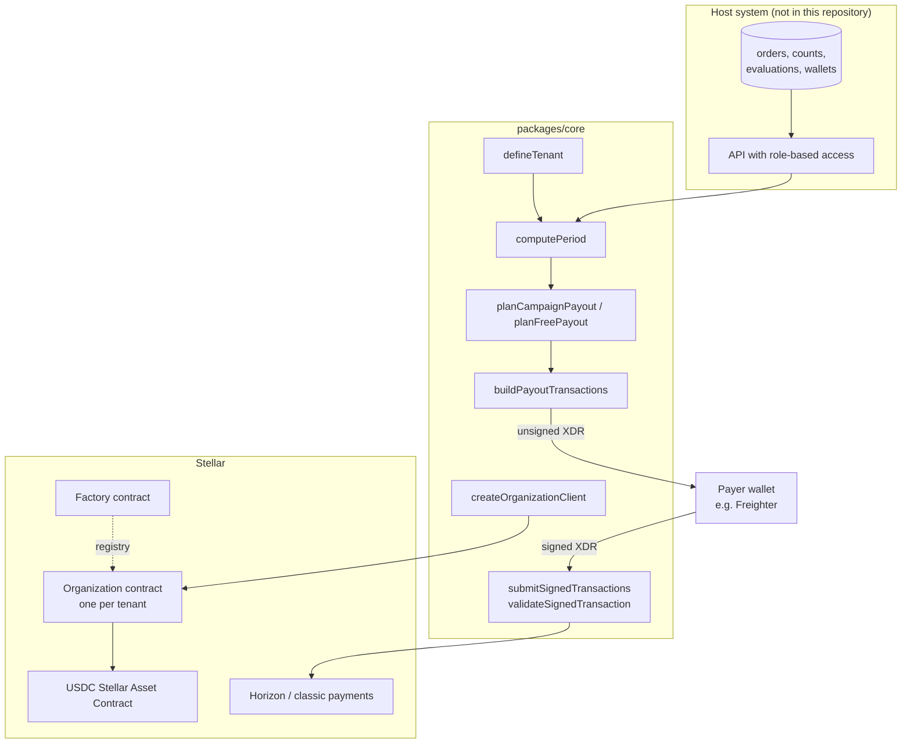
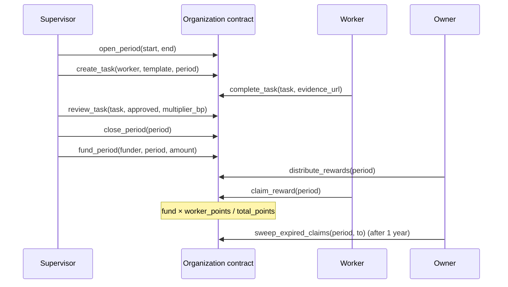

# Architecture

Harmony has two layers:

1. **Off-chain engine** (`packages/core`): turns operational activity into
   points and fund shares, plans payouts and builds/validates Stellar
   transactions. It is a library: no server, no database, no environment
   variables. A host system (a warehouse management system, "FMS") calls it.
2. **On-chain layer** (`contracts/`): Soroban contracts that hold the period
   fund and let each worker claim its proportional share.

## Payout rails

| | Rail A — direct payment | Rail B — organization contract |
|---|---|---|
| Where the money sits until payday | The tenant's payer wallet | Inside the tenant's Organization contract |
| Who decides the split | `computePeriod` + `planCampaignPayout` (off-chain) | The contract: `fund × worker points / total points` |
| Who signs | The payer, once per batch of up to 20 payments | Supervisor/Owner (tasks, reviews, distribution) and each worker (claim) |
| Custody | Non-custodial: the engine never holds keys | Contract custody until each claim |
| Status | Used on mainnet | Testnet pilot |

The two rails share the scoring. To encode an inventory campaign on-chain,
`inventoryMultipliersBp` converts each worker's adjusted points into a review
multiplier so that the contract's proportional split reproduces the off-chain
shares (and gives 0 to whoever did not qualify).

## Lifecycle of a period

Period states only move forward: `Open → Closed → Distributed`.
Task states only move forward: `Assigned → Completed → Approved | Rejected`, or
`Assigned → Skipped`.

## Roles (on-chain)

| Role | Can |
|---|---|
| Owner (one per contract) | everything a Supervisor can; add/remove Supervisors; pause/unpause; distribute; recover undistributed funds; sweep expired claims; transfer ownership (both parties sign) |
| Supervisor | add new Workers; create/deactivate templates; open/close periods; create/review/skip tasks; fund periods |
| Worker | complete its own tasks; claim its reward |

Factory: a single admin registers organization contracts; transferring the
admin requires both the old and the new admin to sign.

## What the host system is responsible for

The engine trusts the host for the inputs. See [integration.md](integration.md):
role filtering, wallet registry and its change log, the ledger of previous
payments, authorization of who can plan, sign and submit, and persistence.

## Pilot integration notes

In the testnet pilot, the host synchronized each completed picking/packing
order as an on-chain task. `complete_task` requires the worker's own
signature, and workers did not sign from the warehouse floor, so the pilot
recorded every task with the organization's own address as the worker. As a
result the on-chain stats of that pilot do not attribute work per person (see
finding HMY-13). Production bonuses were paid through rail A.
