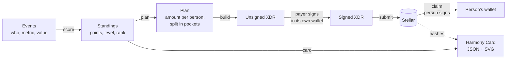

# Kit reference (`packages/kit`)

`@zelena/harmony-kit` generalizes Harmony beyond warehouses. It turns the
activity that any system records into points, levels and pockets, and builds
the Stellar transactions that pay it. It is built on `packages/core` and
inherits its payout planner and its payment rules.

Status: new in 0.2.0. Tested offline and on testnet. **Not audited.** Do not
use it with real money on mainnet without your own review. Nothing is
published to npm yet: clone the repository (see [hackathon.md](hackathon.md)).

## Mental model



- A **program** is plain data: metrics, levels, a payout model and pockets.
  It has no network and no keys.
- A **tenant** (from `packages/core`) is the organization: network, reward
  asset (USDC by default), payer wallet and caps.
- `score`, `plan` and `card` are pure functions. `build`, `submit` and the
  claim functions talk to Horizon.
- The kit never sees a secret key. It builds unsigned XDR; the payer signs.

## The program definition

`defineProgram(input)` validates, fills defaults and returns a deeply frozen
copy. It throws `ProgramConfigError` with a `problems` list naming every
failure at once.

| Field | Required | Rules |
|---|---|---|
| `id` | yes | slug: `a-z`, `0-9`, `-`, `_`, up to 63 characters |
| `name` | yes | text, up to 120 characters |
| `industry`, `description`, `unit` | no | strings |
| `metrics` | yes | non-empty array of `{ id, label, points, cap? }` (below) |
| `quality` | no | `{ weight }` with `weight` between 0 and 1 |
| `minPoints` | no | number >= 0, default 0. Minimum adjusted points to qualify |
| `levels` | no | array, see below. Default: one level `member`, multiplier 1 |
| `payout` | yes | `{ model, ... }`, see [Payout models](#payout-models) |
| `pockets` | no | up to 6, see [Pockets](#pockets). Default: one `instant` pocket with all the money |
| `unreachable` | no | `{ mode: 'hold' \| 'skip', reclaimAfterDays }`. Default `hold`, 30 days |

**Metrics.** Each has a unique slug `id`, a `label`, `points` (a number other
than 0; negative is a penalty) and an optional `cap` (a positive number: the
most units counted per person and period). At least one metric must give
positive points.

**Levels.** Each has `id` (slug), `name`, `minLifetimePoints` (>= 0) and
`multiplier` (> 0 and <= 5, default 1). They must be sorted by strictly
increasing `minLifetimePoints`, and the first must start at 0.

**Pockets.** Each has `id` (slug), `label`, `share` (> 0 and <= 1, at most 4
decimals) and a `rule`. The shares must add up to exactly 1.

A rule is `{ type: 'instant' }`, or `{ type: 'expires' | 'unlocks', afterDays }`
(or `afterSeconds`; give exactly one). The delay must be above 0 and at most
10 years.

**Unreachable.** `reclaimAfterDays` is above 0 and at most 3650.

Minimal valid program:

```js
const { defineProgram } = require('./packages/kit/src');

const program = defineProgram({
  id: 'support-desk',
  name: 'Support desk',
  metrics: [
    { id: 'ticket_solved', label: 'Ticket solved', points: 5, cap: 200 },
    { id: 'reopened', label: 'Ticket reopened', points: -5 },
  ],
  quality: { weight: 0.4 },
  minPoints: 20,
  levels: [
    { id: 'rookie', name: 'Rookie', minLifetimePoints: 0, multiplier: 1 },
    { id: 'pro', name: 'Pro', minLifetimePoints: 500, multiplier: 1.1 },
  ],
  payout: { model: 'proportional', pool: 300 },
  pockets: [
    { id: 'now', label: 'Available now', share: 0.85, rule: { type: 'instant' } },
    { id: 'learning', label: 'Learning budget', share: 0.15, rule: { type: 'expires', afterDays: 45 } },
  ],
});
```

Fourteen ready-made programs live in `packages/kit/templates/` (one JSON file
each, `{ meta, program }`). `templates()` lists them and `template(id)`
returns a fresh editable copy of the `program` part. The table is in
[use-cases.md](use-cases.md#the-14-templates).

## Scoring

`score(program, { events, participants?, quality?, lifetime? })` is pure: no
network, no clock.

Events are `{ participantId, metric, value? }`. `value` defaults to 1 and must
be a finite number between 0 and 1e9 (`INVALID_EVENT_VALUE` otherwise). Other
fields (for example `at` and `ref` from the connectors) are ignored.
`participants` lists people who must appear even with no events.

- An unknown metric throws `UNKNOWN_METRIC`. With `ignoreUnknownMetrics: true`
  such events are skipped instead and counted in `result.ignored`
  (`{ [metric]: count }`, empty when nothing was skipped). Use it when the
  source system sends more event types than the program values.
- If any person's raw, earned or adjusted points, or the lifetime total, is not
  a finite number within the safe integer range, or the adjusted points of all
  people add up past it, `score` throws `POINTS_OUT_OF_RANGE`. Values and caps
  are the limits that keep a bad input (one edited board item) from reaching
  the payout: give the metrics a `cap`.
- `quality` and `lifetime` are read by own property, so a participant id such
  as `constructor` or `toString` is treated like any other id.

For each person:

```
units    = sum of event values per metric, limited by the metric cap
raw      = max(0, sum of units x points)            penalties never go below 0
factor   = 1 - w + w x q                            q = quality 0..1, w = quality.weight
earned   = round(raw x factor)                      added to the lifetime total
adjusted = round(earned x level multiplier)         what the payout is shared by
```

Without a quality score for a person, `factor` is 1. The **level** comes from
the lifetime points *before* the period (`lifetime[participantId]`), so a
period can never promote someone and pay them at the new multiplier in the
same step. The standing also returns `levelAfter`, `lifetimeAfter` and
`rank`. A person **qualifies** when `adjusted > 0` and `adjusted >= minPoints`.
Ties are ordered by `earned`, then by first appearance.

`levelFor(program, lifetimePoints)` returns the level, its step, and how many
points are missing for the next one.

## Payout models

`plan(program, tenant, { standings, people, now?, previous?, walletChanges?, options? })`
decides who gets how much. Only people who qualified are paid. `people` is an
array of `{ participantId, name, wallet }` or a map by `participantId`. `now`
is unix seconds and fixes the dates of the pockets. `options` can override
`pool`, `base`, `topN`, `rate`, `budget`, `includeAlreadyPaid` and
`allowSharedWallets` for one run. Two more inputs: `salt` (see
[The plan id](#the-plan-id), only for reproducible tests) and `sealKey` (see
[Trusting a plan](#trusting-a-plan)).

`plan` refuses, before anything is paid:

| Code | Status | When |
|---|---|---|
| `DUPLICATE_PARTICIPANT` | 400 | the same participant id appears twice in `standings` |
| `SHARED_WALLET` | 409 | two different people who qualified have the same wallet (one person could be paid twice). Pass `options.allowSharedWallets: true` if sharing is intended |
| `NOBODY_QUALIFIED` | 409 | nobody qualified |

| Model | `payout` fields | Rule |
|---|---|---|
| `proportional` | `pool` | The pool is shared among every qualified person by adjusted points. |
| `topN` | `pool`, `topN`, `base?` | Every qualified person with a wallet gets `base`. The pool is shared by adjusted points among the first `topN`, who get it on top. |
| `rate` | `rate`, `budget?` | Each person gets `adjusted x rate`. If the total goes above `budget`, everyone is scaled down so the total equals the budget (`rule.scaledToBudget`). |

Who is paid, withheld or excluded is decided by core's `planCampaignPayout`, so
the kit inherits its rules (the amounts are computed by the kit, see "Exact
money"):

- **Ranking over everybody.** Having a wallet does not change positions.
- **Withheld shares.** A share that belongs to someone with no valid wallet
  address is withheld and listed in `plan.withheld`. It is never given to
  someone else. People without an address are listed in `plan.withoutWallet`.
- **Anti double payment.** Pass `previous` (core's `payouts.summarizePrevious`
  of this campaign, keyed by participant id): whoever already received the
  bonus is left out, listed in `plan.excludedAlreadyPaid`, unless you pass
  `options.includeAlreadyPaid: true`. The host must keep that history.
- **Caps.** The tenant's `payouts.caps` (`perPerson`, `perBatch`) are applied
  when planning and applied again when building.
- **Wallet alerts.** `walletChanges` (participant id to `{ hours }`) flags
  people whose wallet changed recently, in `plan.flagged` and `payment.alert`.
- **Exact money, to the stroop.** The kit decides WHO is paid, withheld or
  excluded with core's planner (so ranks, alerts, wallet checks and the
  already-paid rule are core's), but it computes the AMOUNTS itself, in integer
  stroops (BigInt). The prize pool is shared by the people who share it (every
  qualified person for `proportional` and `rate`; the first `topN` for
  `topN`, including those without a wallet or already paid): each share is
  `floor(pool x points / sum of points)` and the stroops left over are handed
  out one by one by largest remainder, ties going to the better rank. So the
  shares add up to the pool exactly, no share is a whole stroop away from the
  real-number share, and a pool of any size is accepted (there is no
  `POOL_TOO_SMALL`: if the pool has fewer stroops than there are people, some
  get nothing and are not paid). A `topN` payment is `base` plus that share.
  Compared with the engine's own floating-point amounts, everybody except rank 1
  is within 2 stroops; the engine adds its whole rounding residue (up to half a
  stroop per person) to rank 1.
  Everything after that is exact too: each payment is a string with 7 decimals,
  the pockets of a payment add up to it exactly (the rounding remainder goes
  to the first pocket), and so do the totals and the operations. The caps are
  applied to the exact amounts. `money.toStroops` converts without
  floating-point multiplication: numbers go through `toFixed(7)`, strings must
  be plain decimals with at most 7 decimals, and a negative, NaN, exponent,
  text or more-than-7-decimals amount, or one above the int64 maximum, is
  refused with a `HarmonyError(400, code INVALID_AMOUNT)`.

### The plan id

`plan.planId` is the sha256 of what will be paid (tenant, program, network,
asset, dates, people, wallets, amounts, pockets) plus `plan.salt`, 16 random
bytes (hex) generated for every plan. It travels on-chain as the transaction
memo, which ties every payment to its plan. Two things to know:

- It is a **checksum, not authentication.** Anybody who holds a plan can edit
  it and recompute the id (`planIdOf` is exported). `assertPlanIntegrity(plan)`
  therefore only catches accidents: a plan whose id does not match its content,
  pockets that do not add up to the payment, payments that do not add up to
  the total. It does NOT prove the plan is the one the server made. See
  [Trusting a plan](#trusting-a-plan).
- The memo is public, and the participant ids in a plan can be personal data
  (the Azure connector's default id is an email). The salt keeps the memo from
  being matched against a dictionary of likely ids. Keep the plan, which holds
  the salt, private. The same input with the same `salt` gives the same id
  (useful in tests); a different salt gives a different id.

### Trusting a plan

`build` re-derives the SHAPE of the pockets of every payment from the PROGRAM
and refuses the plan (`PLAN_ALTERED`, 400) if they differ: the same pocket ids
in the same order, the same rule type, `rule.at = createdAt + afterSeconds`
(null for instant) and amounts equal to the split of the payment by the
program's shares. It also repeats the plan-level checks of `plan`: a person
once (`DUPLICATE_PARTICIPANT`) and a wallet once (`SHARED_WALLET`, unless
`allowSharedWallets: true` is passed to `build`).

That is all it can do on its own. **WITHOUT `sealKey`, somebody who can edit
the plan and recompute its id can still:**

- change wallets (to any address, or to any registered address if `wallets`
  is given);
- move amounts between people, within the caps and the payer's balance;
- remove payments;
- move `createdAt` inside the freshness window (and so the dates of the
  pockets, which are re-derived from it);
- change the `salt`, which also hides an earlier payment of the same plan from
  the already-submitted check.

Only the shape of the pockets is re-derived. **The rule: if a plan ever leaves
your server, use `sealKey`.** `wallets` only limits the destinations to the
registered addresses; it does not say who gets what. Three things close the
gap, in order of strength:

1. **Keep `plan` and `built` on the server.** Send the browser only what it
   needs to display, and read the plan back from your own storage by id.
2. **`sealKey`, when the plan must travel through a browser or a queue.**
   Pass a string or Buffer of at least 32 bytes to
   `createProgram({ ..., sealKey })`, or inside the input of the standalone
   `plan` and `build`. `plan()` then adds `seal = HMAC-SHA256(sealKey, planId)`
   (hex) and `build()` REQUIRES a valid seal, compared in constant time:
   `PLAN_NOT_SEALED` if it is missing, `PLAN_ALTERED` if it does not match. The
   key never leaves the server. The id covers the network, so a sealed testnet
   plan cannot be relabelled mainnet. Two guards keep sealing from being turned
   off by accident: if the `sealKey` property is PRESENT but `undefined`,
   `null` or empty (for example `sealKey: process.env.PLAN_SEAL_KEY` with the
   variable unset), `createProgram`, `plan` and `build` throw
   `INVALID_SEAL_KEY` (400); and `build` refuses a plan that carries a `seal`
   when no key was given (`PLAN_SEALED_NO_KEY`, 400). Leave the property out to
   run unsealed.
3. **`wallets`, defense in depth.** Pass the organization's registered wallets
   (an array or a Set) to `build`: every wallet of the plan must be one of
   them, otherwise `UNREGISTERED_DESTINATION` (400).

**What a seal means.** A seal proves that the plan was made by this server with
this key. It does not prove that anybody approved it, and previews are sealed
too. Keep the id of the APPROVED plan on your server and build only that one.

## Pockets

A pocket is a part of each person's reward with its own rule about **when**
the money becomes available and whether it can return to the payer.

| Rule | What `build` creates | Person can claim | Payer can take it back |
|---|---|---|---|
| `instant` | a `payment` | already paid | no |
| `expires` | a claimable balance | before the date | from the date on |
| `unlocks` | a claimable balance | from the date on | never, for somebody who can receive. For somebody who cannot receive yet, see below |

The exact claimants and predicates (`claimantsFor` in `src/build.js`), with
`at` the date of the pocket:

| Kind | Claimants and predicates |
|---|---|
| `expires` | person: `before(at)`; payer: `not(before(at))` |
| `unlocks`, person who can receive | person: `not(before(at))`; no payer claimant |
| `unlocks`, person who cannot receive yet (`hold` mode) | person: `not(before(at))`; payer: `not(before(max(at + reclaimAfterSeconds, holdUntil)))`, so the person always has the whole reclaim window after the unlock date |
| `hold` (an `instant` pocket for someone who cannot receive yet) | person: unconditional; payer: `not(before(holdUntil))`, with `holdUntil = createdAt + reclaimAfterDays` |

**The hold rule.** After the hold date the payer can take the money back. A
person who never opens the account therefore cannot lock the money forever, and
neither can an `unlocks` pocket: it gets the payer claimant above, from the
unlock date plus the reclaim window (never at the same second as the person). `built.operations[].payerCanReclaimFrom`
reports the date, and `reason` says why the person was treated as unable to
receive.

**Pockets control when money becomes available and whether it returns to the
payer. They do not control where it is spent after it is claimed.** Once a
person claims, the asset is theirs. Restricting merchants would need a card
or anchor partner, which this kit does not include.

### People who cannot receive yet

`build` loads each recipient's account and treats the person as able to
receive a plain payment only if the trustline for the reward asset exists, is
authorized (`is_authorized` is not false) and has room: `limit - balance -
buying_liabilities` is at least the sum of the person's `instant` pockets.
Otherwise the person cannot receive yet, with the reason recorded (`account
does not exist`, `no trustline for the reward asset`, `trustline not
authorized`, `trustline limit too low`).

Such a person is not skipped when `unreachable.mode` is `hold` (the default).
Their `instant` pocket becomes a claimable balance, claimable at any time by
them, that the payer can take back after `reclaimAfterDays`; their `unlocks`
pockets also get the payer claimant described above; their `expires` pockets
are built as usual. With `mode: 'skip'` the person is left out and listed in
`built.skipped` with the reason. Someone with no address at all is withheld by
the planner (see above).

### Reserve cost

Each claimant of a claimable balance costs the payer one base reserve of
0.5 XLM, returned by the network when the balance is claimed. So an `unlocks`
pocket of somebody who can receive reserves 0.5 XLM, and `expires`, `hold` and
the `unlocks` pocket of somebody who cannot receive yet reserve 1 XLM each (two
claimants). Fees are 0.0001 XLM per operation. `build` reports `feeXlm` and
`reserveXlm` and refuses to build if the payer's XLM does not cover the
minimum balance, the reserves and the fees (`INSUFFICIENT_XLM`).

## Build, sign, submit

```js
const built = await harmony.build({ plan, payer });   // payer: G... address
// built.xdrs   unsigned transactions (up to 20 operations each)
// built.hashes the hash of each one. KEEP THESE on the server side.
// built.operations  one row per payment or claimable balance, with balanceId
const receipt = await harmony.submit({ built, signedXdrs });
```

`build(program, tenant, input)` takes these inputs:

| Input | Default | Meaning |
|---|---|---|
| `plan` | required | the `plan()` result |
| `payer` | required | the account that will sign (`G...`) |
| `horizon` | the tenant's | injectable (`loadAccount`, `transactions`) for tests |
| `baseReserveXlm` | 0.5 | network base reserve |
| `now` | the clock | unix seconds, the same convention as `plan()` |
| `maxPlanAgeSeconds` | 86400 | oldest plan that may still be built |
| `sealKey` | none | require a valid seal (see [Trusting a plan](#trusting-a-plan)); a present but empty key throws `INVALID_SEAL_KEY` |
| `wallets` | none | registered wallets: every payment wallet must be one |
| `allowSharedWallets` | `false` | allow two people at the same wallet (`SHARED_WALLET` otherwise) |
| `checkAlreadySubmitted` | `true` | look for a previous submission of this plan |
| `alreadySubmitted` | `false` | the host knows it was submitted: refuse without a lookup |
| `maxLookupPages` | 25 | pages of 200 transactions the lookup may read at most |

and returns `planId`, `network`, `networkPassphrase`, `asset`, `payer`, `xdrs`,
`hashes`, `operations`, `skipped`, `total`, `payerBalance`, `feeXlm`,
`reserveXlm` and `validUntil`: the unix time until which the transactions can
still be submitted (the latest `maxTime`).

`build` checks, in order: the payer address; plan integrity; that the plan
belongs to this tenant, program, network and asset (`PLAN_MISMATCH`); the seal
(if a `sealKey` is given); that the pockets match the program
(`PLAN_ALTERED`); a person once and a wallet once (`DUPLICATE_PARTICIPANT`, `SHARED_WALLET`); the `wallets` list; on mainnet, that the payer is the tenant's registered
`payerWallet` (`UNEXPECTED_PAYER`); freshness; the caps; that the plan was not
already submitted; the payer's asset balance (`INSUFFICIENT_BALANCE`) and XLM
(`INSUFFICIENT_XLM`). It loads each recipient once to learn whether it can
receive (see [People who cannot receive yet](#people-who-cannot-receive-yet)).
People with an invalid address, or whose wallet is the payer's, are listed in
`built.skipped`. Transactions have consecutive sequence numbers, a 30 minute
time bound and the `planId` as hash memo.

**Freshness (`PLAN_EXPIRED`, 409).** Pocket and hold dates are computed from
`plan.createdAt`, so a plan built late could produce a balance the payer may
take back at once. `build` therefore refuses a plan older than
`maxPlanAgeSeconds`, a clock earlier than the plan (beyond 5 minutes of skew),
and any date after which the payer may take money back that is not at least 30
minutes (the validity window of the transactions) in the future. An `unlocks`
date in the past is harmless for somebody who can receive: that pocket is
simply claimable at once.

**Already submitted (`PLAN_ALREADY_SUBMITTED`, 409).** Before building,
`build` pages back through the payer's transactions (newest first, 200 per
page) until it reaches one older than the plan (its `createdAt` minus 5
minutes) or the list ends, and refuses if a transaction whose source is the
payer has the plan id as hash memo; `error.hashes` lists them. It reads at
most `maxLookupPages` pages (default 25). If it does not get back to the time
of the plan within them, it cannot know, so it fails closed with
`CANNOT_CHECK_SUBMISSIONS`: pass `alreadySubmitted` from the host's own
records instead (or raise `maxLookupPages`). This is evidence found on the
ledger, not a guarantee: the host's own record is the primary control. Mark the
plan as submitted when you sign, and pass `alreadySubmitted: true` (no lookup
is made). If the lookup itself fails, the error propagates: `build` fails
closed. A horizon object without `transactions()` raises
`CANNOT_CHECK_SUBMISSIONS` too; pass `checkAlreadySubmitted: false` only when
the host records submissions itself. A changed `salt` changes the plan id, so
an unsealed plan whose salt was edited is not found (see
[Trusting a plan](#trusting-a-plan)).

`submit` accepts a signed transaction only if all of these hold, and checks
everything before sending anything:

1. Its hash is one of `built.hashes`. A signature does not change the hash,
   so any edit between build and signature is detected
   (`NOT_THE_BUILT_TRANSACTION`). Never take `built.hashes` back from a
   browser: **this is the control.**
2. `validateOperations` passes, as a structural second check: no fee-bump;
   the transaction expires (a `timeBounds.maxTime` that is not 0) and its fee
   is at most 100 times the usual fee per operation; every operation is a
   `payment` or `createClaimableBalance`; no operation has a different source
   account; the asset is the reward asset (code and issuer); destinations and
   claimants are wallets of the plan; a claimable balance has exactly one
   recipient and at most one payer claimant; and the payer can only be a "take
   it back later" claimant, never able to claim before the person can (for an
   `unlocks` pocket, never before the unlock date). Used on its own it is NOT
   sufficient: it cannot know the amounts or the people. The hash check
   against a `built` kept on the server is the control.
3. On mainnet the source is the registered payer. The same transaction is not
   sent twice. By default (`verifySignatures: true`) the kit verifies that at
   least one signature is a valid signature of the transaction hash by the
   source account's own key, and refuses otherwise (`BAD_SIGNATURE`, 400),
   because a wrongly signed transaction in a batch would only be refused by the
   network after the earlier ones were already accepted. An account with
   custom signers (multisig) signs with other keys: set
   `verifySignatures: false` and let the network judge the signatures.

Transactions are sent in order and sending stops at the first failure. There
are two kinds of failure, and they need different handling:

| | Definitive rejection | Unknown outcome |
|---|---|---|
| What happened | the network answered with Stellar `result_codes` | timeout, HTTP 5xx such as 504, network error: any error without result codes |
| Error | `HarmonyError` 502, `code: 'TRANSACTION_REJECTED'` | `HarmonyError` 504, `code: 'SUBMISSION_UNKNOWN'` |
| The transaction | was NOT applied (`failedHash`, `resultCodes`) | MAY have been applied (`unknownHash`) |
| `submitted` | the transactions that did go through | the transactions that did go through |
| `notSent` | hashes after it, which were not sent | hashes after it, which were not sent |

### After you sign: the three rules

1. **If the outcome is unknown (`SUBMISSION_UNKNOWN`), resubmit the SAME signed
   transactions. Never build the plan again.** Resubmitting is safe: the
   network deduplicates by hash and answers with the stored result. Building
   again makes new transactions with new sequence numbers, and pays the plan a
   second time. `build` refuses it when it can see the first submission
   (`PLAN_ALREADY_SUBMITTED`), but do not rely on that alone.
2. **Record `submitted` as you go.** Keep `error.submitted` (and, after
   success, `receipt.transactions`) with the plan, and mark the plan as
   submitted before you hand the XDRs to the payer.
3. **On `TRANSACTION_REJECTED` the later transactions were not sent, but they
   stay valid until `built.validUntil`.** Whoever they would have paid is
   unpaid and needs a NEW plan: call `plan` again with `previous` (core's
   `payouts.summarizePrevious` of what was already paid) so that the people paid
   by the transactions in `submitted` are left out. Do that only AFTER
   `validUntil` has passed (the unsent signed transactions can no longer be
   applied), or never hand the old signed transactions to anything that could
   still submit them. Planning earlier could pay the same people twice.

## Claiming

The person's side. All three functions use the tenant's Horizon.

```js
const waiting = await harmony.listClaimable({ wallet, sponsors: [PAYER] });
// [{ balanceId, amount, sponsor, claimableNow, from, until }]
const { xdrs, addsTrustline } = await harmony.buildClaim({
  wallet,
  balanceIds: waiting.filter((b) => b.claimableNow).map((b) => b.balanceId),
});
// the person signs xdrs in their wallet
await harmony.submitClaim({ wallet, signedXdrs });
```

Anybody can create a claimable balance that names your wallet as a claimant, so
a list without a filter can be padded with dust or with balances you do not
want to claim. Pass `sponsors` (an array or a Set of the payer accounts you
expect) and only balances created by one of them are returned. It is
recommended in the "claim everything" flow above.

`buildClaim` adds a `changeTrust` for the reward asset when the account lacks
it, so someone who never held the asset claims **with one signature**. Up to
19 claims go in a transaction. The account must already exist (a first XLM
deposit, enough for fees and the trustline reserve); otherwise it fails with
`ACCOUNT_NOT_FOUND`. `submitClaim` accepts only the asset's trustline and
claim operations, built for that wallet. Like `submit`, it tells a definitive
rejection (502, `TRANSACTION_REJECTED`, result codes) from an unknown outcome
(504, `SUBMISSION_UNKNOWN`: timeout, 5xx, network error; resubmitting the same
signed claim is safe, the network deduplicates by hash).

The payer uses the same functions to take back an expired pocket or an
unclaimed hold.

## The Harmony Card

`card({ participant, standing, of?, payment?, receipt?, period? })` returns
plain JSON (`kind: 'harmony-card'`, `version: 1`) and
`renderCardSvg(card)` returns a standalone 680 x 420 SVG with no external
fonts or images. The card holds the level (and the next step), points
(earned, adjusted, lifetime), rank, the pockets with a status, and the
transaction hashes with explorer links as proof. It never holds a secret or a
full address. Without a `receipt` it is a preview (`preview: true`). Pocket
status is `planned`, `paid`, `claimable`, `locked`, `expired` or `waiting`.
Text is escaped, because names come from the host.

## API of `createProgram`

```js
const crypto = require('node:crypto');
const { createProgram } = require('./packages/kit/src');

// In production load the same 32+ random bytes from your secret store. If the property is
// present it must hold a real key: undefined, null or '' throw INVALID_SEAL_KEY.
const sealKey = crypto.randomBytes(32);

const harmony = createProgram({
  tenant: { id: 'acme-demo', network: 'testnet' },   // config or defineTenant() result
  program: 'last-mile-delivery',                     // template id, definition or defineProgram() result
  overrides: { payout: { model: 'rate', rate: 0.02, budget: 800 } }, // optional, replaces whole fields
  sealKey,                                           // optional, >= 32 bytes: seal every plan
});
```

`overrides` is a **shallow merge**: `{ ...template, ...overrides }`. Giving
`payout` replaces the entire payout object, and giving `metrics` replaces the
whole metrics array (it does not add to it). `sealKey` is described in
[Trusting a plan](#trusting-a-plan): leave it out to run unsealed, but never
pass a value that may be missing (`sealKey: process.env.X` throws when `X` is
unset). The result has:

| Member | Does |
|---|---|
| `tenant`, `program` | the frozen tenant and program |
| `score(input)` | standings and totals |
| `plan(input)` | payout plan (pure) |
| `build(input)` | unsigned XDR (inputs in the table above) |
| `submit(input)` | validate and send (`{ built, signedXdrs, horizon?, verifySignatures? }`) |
| `listClaimable(input)`, `buildClaim(input)`, `submitClaim(input)` | the person's side |
| `card(input)`, `renderCardSvg(card)` | the Harmony Card |
| `explorerUrl(hash)` | a public explorer link for the tenant's network |

`horizon` is injectable on every network call, which is how the tests run
offline. The module also exports the same functions standalone (`defineProgram`,
`score`, `levelFor`, `plan`, `planIdOf`, `assertPlanIntegrity`, `sealOf`, `build`,
`submit`, `validateOperations`, `listClaimable`, `buildClaim`, `submitClaim`,
`predicateAllows`, `card`, `renderCardSvg`, `explorerUrl`, `money`),
`templates`, `template`, `PAYOUT_MODELS`, `POCKET_RULES` and
`ProgramConfigError`. The standalone `plan`, `build`, `submit` and `card` take
the program and tenant as their first arguments.

## Where to go next

- Business cases and programs for each: [use-cases.md](use-cases.md)
- Adopting it one step at a time: [adoption-levels.md](adoption-levels.md)
- Running it in ten minutes: [hackathon.md](hackathon.md)
- The engine underneath: [payouts.md](payouts.md), [scoring.md](scoring.md)
