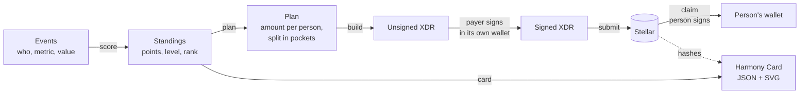

# Kit reference (`packages/kit`)

`@zelena/harmony-kit` generalizes Harmony beyond warehouses. It turns the
activity that any system records into points, levels and pockets, and builds
the Stellar transactions that pay it. It is built on `packages/core` and
inherits its payout planner and its payment rules.

Status: new in 0.2.0. Tested offline and on testnet. **Not audited.** Do not
use it with real money on mainnet without your own review. Nothing is
published to npm yet: clone the repository (see [hackathon.md](hackathon.md)).

## Mental model



- A **program** is plain data: metrics, levels, a payout model and pockets.
  It has no network and no keys.
- A **tenant** (from `packages/core`) is the organization: network, reward
  asset (USDC by default), payer wallet and caps.
- `score`, `plan` and `card` are pure functions. `build`, `submit` and the
  claim functions talk to Horizon.
- The kit never sees a secret key. It builds unsigned XDR; the payer signs.

## The program definition

`defineProgram(input)` validates, fills defaults and returns a deeply frozen
copy. It throws `ProgramConfigError` with a `problems` list naming every
failure at once.

| Field | Required | Rules |
|---|---|---|
| `id` | yes | slug: `a-z`, `0-9`, `-`, `_`, up to 63 characters |
| `name` | yes | text, up to 120 characters |
| `industry`, `description`, `unit` | no | strings |
| `metrics` | yes | non-empty array of `{ id, label, points, cap? }` (below) |
| `quality` | no | `{ weight }` with `weight` between 0 and 1 |
| `minPoints` | no | number >= 0, default 0. Minimum adjusted points to qualify |
| `levels` | no | array, see below. Default: one level `member`, multiplier 1 |
| `payout` | yes | `{ model, ... }`, see [Payout models](#payout-models) |
| `pockets` | no | up to 6, see [Pockets](#pockets). Default: one `instant` pocket with all the money |
| `unreachable` | no | `{ mode: 'hold' \| 'skip', reclaimAfterDays }`. Default `hold`, 30 days |

**Metrics.** Each has a unique slug `id`, a `label`, `points` (a number other
than 0; negative is a penalty) and an optional `cap` (a positive number: the
most units counted per person and period). At least one metric must give
positive points.

**Levels.** Each has `id` (slug), `name`, `minLifetimePoints` (>= 0) and
`multiplier` (> 0 and <= 5, default 1). They must be sorted by strictly
increasing `minLifetimePoints`, and the first must start at 0.

**Pockets.** Each has `id` (slug), `label`, `share` (> 0 and <= 1, at most 4
decimals) and a `rule`. The shares must add up to exactly 1.

A rule is `{ type: 'instant' }`, or `{ type: 'expires' | 'unlocks', afterDays }`
(or `afterSeconds`; give exactly one). The delay must be above 0 and at most
10 years.

**Unreachable.** `reclaimAfterDays` is above 0 and at most 3650.

Minimal valid program:

```js
const { defineProgram } = require('./packages/kit/src');

const program = defineProgram({
  id: 'support-desk',
  name: 'Support desk',
  metrics: [
    { id: 'ticket_solved', label: 'Ticket solved', points: 5, cap: 200 },
    { id: 'reopened', label: 'Ticket reopened', points: -5 },
  ],
  quality: { weight: 0.4 },
  minPoints: 20,
  levels: [
    { id: 'rookie', name: 'Rookie', minLifetimePoints: 0, multiplier: 1 },
    { id: 'pro', name: 'Pro', minLifetimePoints: 500, multiplier: 1.1 },
  ],
  payout: { model: 'proportional', pool: 300 },
  pockets: [
    { id: 'now', label: 'Available now', share: 0.85, rule: { type: 'instant' } },
    { id: 'learning', label: 'Learning budget', share: 0.15, rule: { type: 'expires', afterDays: 45 } },
  ],
});
```

Eleven ready-made programs live in `packages/kit/templates/` (one JSON file
each, `{ meta, program }`). `templates()` lists them and `template(id)`
returns a fresh editable copy of the `program` part. The table is in
[use-cases.md](use-cases.md#the-11-templates).

## Scoring

`score(program, { events, participants?, quality?, lifetime? })` is pure: no
network, no clock.

Events are `{ participantId, metric, value? }`. `value` defaults to 1 and must
be a number >= 0. Other fields (for example `at` and `ref` from the
connectors) are ignored. An unknown metric throws `UNKNOWN_METRIC`.
`participants` lists people who must appear even with no events.

For each person:

```
units    = sum of event values per metric, limited by the metric cap
raw      = max(0, sum of units x points)            penalties never go below 0
factor   = 1 - w + w x q                            q = quality 0..1, w = quality.weight
earned   = round(raw x factor)                      added to the lifetime total
adjusted = round(earned x level multiplier)         what the payout is shared by
```

Without a quality score for a person, `factor` is 1. The **level** comes from
the lifetime points *before* the period (`lifetime[participantId]`), so a
period can never promote someone and pay them at the new multiplier in the
same step. The standing also returns `levelAfter`, `lifetimeAfter` and
`rank`. A person **qualifies** when `adjusted > 0` and `adjusted >= minPoints`.
Ties are ordered by `earned`, then by first appearance.

`levelFor(program, lifetimePoints)` returns the level, its step, and how many
points are missing for the next one.

## Payout models

`plan(program, tenant, { standings, people, now?, previous?, walletChanges?, options? })`
decides who gets how much. Only people who qualified are paid. `people` is an
array of `{ participantId, name, wallet }` or a map by `participantId`. `now`
is unix seconds and fixes the dates of the pockets. `options` can override
`pool`, `base`, `topN`, `rate`, `budget` and `includeAlreadyPaid` for one run.

| Model | `payout` fields | Rule |
|---|---|---|
| `proportional` | `pool` | The pool is shared among every qualified person by adjusted points. |
| `topN` | `pool`, `topN`, `base?` | Every qualified person with a wallet gets `base`. The pool is shared by adjusted points among the first `topN`, who get it on top. |
| `rate` | `rate`, `budget?` | Each person gets `adjusted x rate`. If the total goes above `budget`, everyone is scaled down so the total equals the budget (`rule.scaledToBudget`). |

The split between people is done by core's `planCampaignPayout`, so the kit
inherits its rules:

- **Ranking over everybody.** Having a wallet does not change positions.
- **Withheld shares.** A share that belongs to someone with no valid wallet
  address is withheld and listed in `plan.withheld`. It is never given to
  someone else. People without an address are listed in `plan.withoutWallet`.
- **Anti double payment.** Pass `previous` (core's `payouts.summarizePrevious`
  of this campaign, keyed by participant id): whoever already received the
  bonus is left out, listed in `plan.excludedAlreadyPaid`, unless you pass
  `options.includeAlreadyPaid: true`. The host must keep that history.
- **Caps.** The tenant's `payouts.caps` (`perPerson`, `perBatch`) are applied
  when planning and applied again when building.
- **Wallet alerts.** `walletChanges` (participant id to `{ hours }`) flags
  people whose wallet changed recently, in `plan.flagged` and `payment.alert`.
- **Exact money.** Amounts are integer stroops. Each payment is a string with
  7 decimals, and the pockets of a payment always add up to it exactly (the
  rounding remainder goes to the first pocket).

The plan has a `planId`: the sha256 of what will be paid. It travels on-chain
as the transaction memo. `assertPlanIntegrity(plan)` rejects a plan that was
edited after it was created.

## Pockets

A pocket is a part of each person's reward with its own rule about **when**
the money becomes available and whether it can return to the payer.

| Rule | What `build` creates | Person can claim | Payer can take it back |
|---|---|---|---|
| `instant` | a `payment` | already paid | no |
| `expires` | a claimable balance | before the date | from the date on |
| `unlocks` | a claimable balance | from the date on | never |

The exact claimants and predicates (`claimantsFor` in `src/build.js`), with
`at` the date of the pocket:

| Kind | Claimants and predicates |
|---|---|
| `expires` | person: `before(at)`; payer: `not(before(at))` |
| `unlocks` | person: `not(before(at))`; no payer claimant |
| `hold` (an `instant` pocket for someone who cannot receive yet) | person: unconditional; payer: `not(before(holdUntil))`, with `holdUntil = createdAt + reclaimAfterDays` |

**Pockets control when money becomes available and whether it returns to the
payer. They do not control where it is spent after it is claimed.** Once a
person claims, the asset is theirs. Restricting merchants would need a card
or anchor partner, which this kit does not include.

### People who cannot receive yet

Someone with a Stellar address whose account does not exist, or has no
trustline for the reward asset, is not skipped when `unreachable.mode` is
`hold` (the default). Their `instant` pocket becomes a claimable balance,
claimable at any time by them, that the payer can take back after
`reclaimAfterDays`. Their `expires` and `unlocks` pockets are built as usual.
With `mode: 'skip'` the person is left out and listed in `built.skipped`.
Someone with no address at all is withheld by the planner (see above).

### Reserve cost

Each claimant of a claimable balance costs the payer one base reserve of
0.5 XLM, returned by the network when the balance is claimed. So an `unlocks`
pocket reserves 0.5 XLM, and `expires` and `hold` reserve 1 XLM each (two
claimants). Fees are 0.0001 XLM per operation. `build` reports `feeXlm` and
`reserveXlm` and refuses to build if the payer's XLM does not cover the
minimum balance, the reserves and the fees (`INSUFFICIENT_XLM`).

## Build, sign, submit

```js
const built = await harmony.build({ plan, payer });   // payer: G... address
// built.xdrs   unsigned transactions (up to 20 operations each)
// built.hashes the hash of each one. KEEP THESE on the server side.
// built.operations  one row per payment or claimable balance, with balanceId
const receipt = await harmony.submit({ built, signedXdrs });
```

`build` checks, in order: the payer address; plan integrity; that the plan
belongs to this tenant, program, network and asset (`PLAN_MISMATCH`); on
mainnet, that the payer is the tenant's registered `payerWallet`
(`UNEXPECTED_PAYER`); the caps; the payer's asset balance
(`INSUFFICIENT_BALANCE`) and XLM. It looks up each recipient once to learn
whether it exists and has a trustline. People with an invalid address, or
whose wallet is the payer's, are listed in `built.skipped`. Transactions have
consecutive sequence numbers, a 30 minute time bound and the `planId` as hash
memo.

`submit` accepts a signed transaction only if all of these hold, and checks
everything before sending anything:

1. Its hash is one of `built.hashes`. A signature does not change the hash,
   so any edit between build and signature is detected
   (`NOT_THE_BUILT_TRANSACTION`). Never take `built.hashes` back from a
   browser.
2. `validateOperations` passes, independently of (1): no fee-bump; every
   operation is a `payment` or `createClaimableBalance`; no operation has a
   different source account; the asset is the reward asset (code and issuer);
   destinations and claimants are wallets of the plan; a claimable balance has
   exactly one recipient and at most one payer claimant; and the payer can
   only be a "take it back later" claimant, never able to claim while the
   person can.
3. On mainnet the source is the registered payer. The same transaction is not
   sent twice. At least one signature is present (the network verifies it).

Transactions are sent in order. If the network rejects one, `submit` throws a
`HarmonyError` with status 502 and `error.submitted` lists the transactions
that did go through, so the host can record them.

## Claiming

The person's side. All three functions use the tenant's Horizon.

```js
const waiting = await harmony.listClaimable({ wallet });
// [{ balanceId, amount, sponsor, claimableNow, from, until }]
const { xdrs, addsTrustline } = await harmony.buildClaim({
  wallet,
  balanceIds: waiting.filter((b) => b.claimableNow).map((b) => b.balanceId),
});
// the person signs xdrs in their wallet
await harmony.submitClaim({ wallet, signedXdrs });
```

`buildClaim` adds a `changeTrust` for the reward asset when the account lacks
it, so someone who never held the asset claims **with one signature**. Up to
19 claims go in a transaction. The account must already exist (a first XLM
deposit, enough for fees and the trustline reserve); otherwise it fails with
`ACCOUNT_NOT_FOUND`. `submitClaim` accepts only the asset's trustline and
claim operations, built for that wallet.

The payer uses the same functions to take back an expired pocket or an
unclaimed hold.

## The Harmony Card

`card({ participant, standing, of?, payment?, receipt?, period? })` returns
plain JSON (`kind: 'harmony-card'`, `version: 1`) and
`renderCardSvg(card)` returns a standalone 680 x 420 SVG with no external
fonts or images. The card holds the level (and the next step), points
(earned, adjusted, lifetime), rank, the pockets with a status, and the
transaction hashes with explorer links as proof. It never holds a secret or a
full address. Without a `receipt` it is a preview (`preview: true`). Pocket
status is `planned`, `paid`, `claimable`, `locked`, `expired` or `waiting`.
Text is escaped, because names come from the host.

## API of `createProgram`

```js
const { createProgram } = require('./packages/kit/src');

const harmony = createProgram({
  tenant: { id: 'acme-demo', network: 'testnet' },   // config or defineTenant() result
  program: 'last-mile-delivery',                     // template id, definition or defineProgram() result
  overrides: { payout: { model: 'rate', rate: 0.02, budget: 800 } }, // optional, replaces whole fields
});
```

`overrides` replaces whole top-level fields: giving `payout` replaces the
entire payout object. The result has:

| Member | Does |
|---|---|
| `tenant`, `program` | the frozen tenant and program |
| `score(input)` | standings and totals |
| `plan(input)` | payout plan (pure) |
| `build(input)` | unsigned XDR (`{ plan, payer, horizon?, baseReserveXlm? }`) |
| `submit(input)` | validate and send (`{ built, signedXdrs, horizon? }`) |
| `listClaimable(input)`, `buildClaim(input)`, `submitClaim(input)` | the person's side |
| `card(input)`, `renderCardSvg(card)` | the Harmony Card |
| `explorerUrl(hash)` | a public explorer link for the tenant's network |

`horizon` is injectable on every network call, which is how the tests run
offline. The module also exports the same functions standalone (`defineProgram`,
`score`, `levelFor`, `plan`, `planIdOf`, `assertPlanIntegrity`, `build`,
`submit`, `validateOperations`, `listClaimable`, `buildClaim`, `submitClaim`,
`predicateAllows`, `card`, `renderCardSvg`, `explorerUrl`, `money`),
`templates`, `template`, `PAYOUT_MODELS`, `POCKET_RULES` and
`ProgramConfigError`. The standalone `plan`, `build`, `submit` and `card` take
the program and tenant as their first arguments.

## Where to go next

- Business cases and programs for each: [use-cases.md](use-cases.md)
- Adopting it one step at a time: [adoption-levels.md](adoption-levels.md)
- Running it in ten minutes: [hackathon.md](hackathon.md)
- The engine underneath: [payouts.md](payouts.md), [scoring.md](scoring.md)
