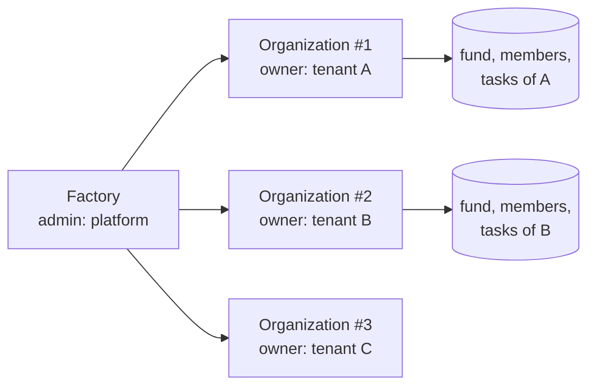

# Multi-tenant model

A **tenant** is one organization: one company or warehouse operator with its
own people, its own money and its own rules.

## Isolation on-chain



- Each tenant has its **own Organization contract instance**. Members, tasks,
  periods and funds live in that instance's storage; no function reads
  another instance.
- Each instance has its **own Owner** and its own **reward asset**, fixed at
  `initialize`.
- The **Factory** is only a directory (`org_id → contract address`). It holds
  no funds and has no authority over organizations: the Factory admin cannot
  move a tenant's funds or change its members. See finding HMY-09 for the
  limits of the registry.

## Isolation off-chain

```js
const { createHarmony } = require('@zelena/harmony-core');

const tenantA = createHarmony({ id: 'tenant-a', network: 'mainnet', rpcUrl, contracts: { organization: 'CA…' },
  payouts: { payerWallet: 'GA…', caps: { perPerson: 100, perBatch: 1000 } } });
const tenantB = createHarmony({ id: 'tenant-b', network: 'testnet',
  scoring: { pointsPerPicking: 5, weights: { performance: 0.7, attendance: 0, evaluation: 0.3 } } });
```

- `defineTenant` validates the configuration and returns a **deeply frozen**
  object; it cannot be modified after creation.
- Every function receives the tenant explicitly. The library has no global
  state, no singletons and does not read environment variables, so two
  tenants in the same process cannot leak configuration into each other
  (covered by `test/tenant.test.js`).
- Payment validation is bound to the tenant: expected reward asset (code +
  issuer), expected payer on mainnet, per-person and per-batch caps.
- The Soroban client is bound to the tenant's organization contract and
  network passphrase.

## What the host must keep per tenant

| Data | Why |
|---|---|
| Tenant configuration | input of `defineTenant` |
| People and their Stellar wallets | destination allowlist for payments |
| Wallet change log | alerts on recently changed wallets |
| Previous payments per campaign (tx hash, wallet, amount) | anti double payment and audit trail |
| Activity per period | input of `computePeriod` |

A host that serves several tenants from one database must scope every query
by tenant; a host with one database per tenant gets that isolation for free.

## Configuration reference

| Field | Default | Meaning |
|---|---|---|
| `id` | — | lowercase slug |
| `network` | — | `testnet` or `mainnet` |
| `rpcUrl` | SDF testnet RPC; none on mainnet | Soroban RPC |
| `horizonUrl` | SDF Horizon of the network | Horizon |
| `rewardAsset` | `USDC` of the network | `{ code, issuer }` |
| `contracts.factory`, `contracts.organization` | `null` | contract ids |
| `scoring.pointsPerPicking` / `pointsPerPacking` | 10 / 10 | base points per completed order |
| `scoring.velocityWeight` / `precisionWeight` | 0.5 / 0.5 | inside the performance component |
| `scoring.weights` | performance 0.5, attendance 0.2, evaluation 0.3 | final score components |
| `scoring.topNDefault` | `null` | default top-N for inventory campaigns |
| `scoring.tokenRate` / `fiatPerToken` | 0.5 / `null` | display only |
| `scoring.inventory` | minPrecision 0.9, penalty 2 | inventory quality rule |
| `payouts.payerWallet` | `null` | expected signer on mainnet |
| `payouts.caps` | none | `perPerson`, `perBatch` |
| `payouts.defaults` | base 15, pool 150, topN 5 | campaign bonus defaults |
