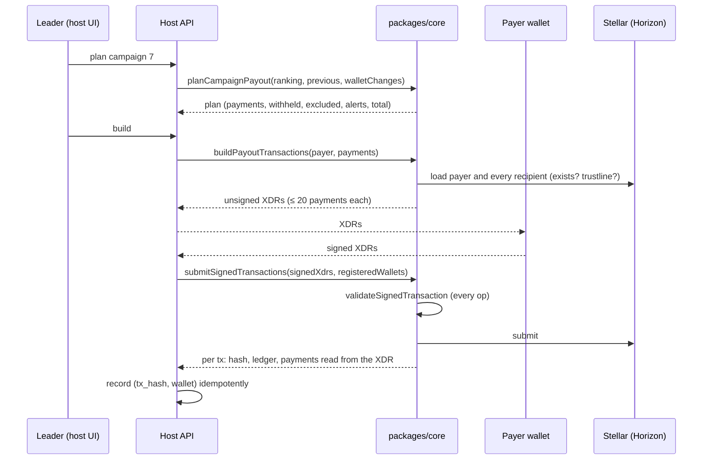

# Payouts

## Rail A — direct payment (non-custodial)

### Planning rules (`planCampaignPayout`)

| Rule | Behavior |
|---|---|
| Base | every participant **with a valid wallet** receives `base` |
| Pool | shared among the top-N by `adjustedPoints`, proportionally |
| Fixed prize | alternative to the pool: each top-N position receives `fixedPrize`; workers with 0 points never enter the top |
| Ranking | computed over **all** participants; having a wallet does not change positions |
| Top worker without wallet | its prize is **withheld** and reported, never redistributed |
| Anti double payment | workers who already received the bonus of this campaign are excluded unless `includeAlreadyPaid` |
| Test payment | `testAmount` split proportionally among people with a wallet; never excludes anybody |
| Stroop exactness | every amount is rounded to 7 decimals; the signed residue goes to rank 1 so the total equals the pool exactly |
| Caps | `perPerson` and `perBatch` (tenant configuration), checked when planning **and** when building |
| Alerts | wallet changed recently (host passes the change log) or different from the wallet of the last payment |

`planFreePayout` pays chosen people either a fixed amount each or a total
split evenly; the even split is exact to the stroop (the remainder goes to the
first recipients).

### Building (`buildPayoutTransactions`)

- On mainnet, the payer must equal `tenant.payouts.payerWallet` when configured.
- Recipients that do not exist or lack the reward asset trustline are skipped
  and reported, never paid blindly; the payer itself is skipped.
- Fails if the payer balance is below the total.
- Batches of 20 payments per transaction, consecutive sequence numbers,
  fee 0.0001 XLM per operation, 30 minute time bound, optional text memo
  (≤ 28 bytes).

### Validation before submitting (`validateSignedTransaction`)

Every operation of every signed transaction must be a `payment` of the
tenant's reward asset (code **and** issuer) to a **registered wallet** of the
tenant; on mainnet the source must be the expected payer; the transaction must
carry at least one signature. Signatures themselves are verified by the
network, not locally (HMY-12). The amounts recorded afterwards are read from
the signed XDR, never from the client request.

## Rail B — Organization contract

1. Supervisor opens a period, creates tasks, workers complete them, supervisor
   reviews them (multiplier in basis points, max 200 %).
2. The period is closed and funded (`fund_period` transfers tokens from the
   funder into the contract).
3. The Owner distributes; from then on points and fund are frozen.
4. Each worker calls `claim_reward` and receives
   `floor(fund × its points / total points)`.
5. One year after distribution, the Owner can sweep what was not claimed.

See [contracts/organization.md](contracts/organization.md) for the exact
preconditions and [audit/findings.md](audit/findings.md) for known limits
(e.g. a worker deactivated after distribution cannot claim).
